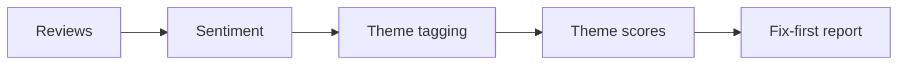

# Customer Feedback Analyzer

> Hundreds of reviews in, a one-page 'what to fix first' report out.

     

**Sector:** Customer Experience  ·  **Project 11 of 50** in my [AI Automation Projects series](https://github.com/Princewill106/Princewill106)

## The problem

Businesses collect reviews on Google, Instagram comments and WhatsApp, but nobody reads them all. The pattern that matters (say, delivery delays mentioned in 40% of complaints) stays invisible until it shows up in revenue.

## How it works



1. **Load** — Read comments with a source and rating from `sample_feedback.csv`.
2. **Sentiment** — A small lexicon with negation handling ('not good') scores each comment from -1 to 1.
3. **Themes** — Comments are tagged with themes using keyword lists you can edit.
4. **Aggregate** — Each theme gets a mention count and average sentiment.
5. **Report** — Themes are ranked by negative impact (mentions × negativity) into `output/feedback_report.md`.

## Features

- Negation-aware sentiment
- Editable theme dictionary
- Impact-ranked fix-first list
- Representative quotes per theme
- Markdown report ready to share

## Quick start

```bash
git clone https://github.com/Princewill106/customer-feedback-analyzer.git
cd customer-feedback-analyzer
python main.py --demo
```

No installs needed: it uses only the Python standard library. The demo runs fully offline using the sample data in this repo.

**Optional: plug in an LLM.** Copy `.env.example` to `.env` and add an Anthropic or OpenAI key. The project will then use the model for the language-heavy steps and fall back to its rule-based logic if a call fails.

Run the tests:

```bash
python -m unittest -v
```

## Sample output

```text
10 comments, overall sentiment -0.30

Theme          Mentions  Avg sent  Impact
delivery              6     -0.67     4.0
app/ordering          2     -1.00     2.0
quality               4     -0.25     1.0
staff                 4     +0.00       0
price                 2     +0.50       0

Fix first: delivery -> "Delivery was late again and the rider was rude"
Saved output/feedback_report.md
```

## Use it in n8n (no code needed)

[`n8n-workflow.json`](n8n-workflow.json) is a ready-to-import n8n version of this project, built for n8n 1.x.

1. In n8n, open **Workflows → Import from File** and choose `n8n-workflow.json`.
2. Click **Test workflow**. It runs the full logic on the sample data built into the *Sample data* node, so you can see the results before connecting anything.
3. Open each output node and connect your accounts: Gmail (OAuth2), Google Sheets (OAuth2). For Google Sheets, pick your spreadsheet and sheet.
4. Adjust the settings at the top of the **Logic** node (thresholds, templates, contacts), then **Activate**.

**Flow:** **Schedule (Mondays 8am)** → Read feedback sheet → **Logic** (Code node)

**Outputs:**
- Email the report

The Logic node is a JavaScript port of the rules in `main.py`, so you can run the project in n8n without Python.

## Use it on your own data

Export comments to CSV with `source,rating,comment` and run `python main.py --input reviews.csv`. Edit `THEMES` in `main.py` to fit your business.

## Project structure

```text
n8n-workflow.json            Importable n8n workflow
.env.example                 Optional API key settings
.gitignore                   Git ignore rules
LICENSE                      MIT license
README.md                    This file
llm.py                       Optional LLM helper (offline fallback)
main.py                      Entry point and core logic
requirements.txt             Dependencies (stdlib only)
sample_feedback.csv          Sample input data for the demo
test_main.py                 Unit tests
```

## Who this is for

- Restaurants, salons and retail stores
- Schools analysing parent surveys
- Product teams triaging app reviews

## Ideas to extend it

- [ ] Pull Google reviews via API
- [ ] Multilingual lexicons (Pidgin, Yoruba, Hausa, Igbo)
- [ ] Weekly trend chart
- [ ] Auto-reply drafts for negative reviews

## About

Built by **Ogbu Ugochukwu Princewill**, AI Automation Lead and robotics engineer. I teach people and businesses to build with AI, not just talk about it. [LinkedIn](https://www.linkedin.com/in/ugochukwu-ogbu-653a0816a)

If this helped you, give it a ⭐ and share what you built with it.

## License

MIT — see [LICENSE](LICENSE).
